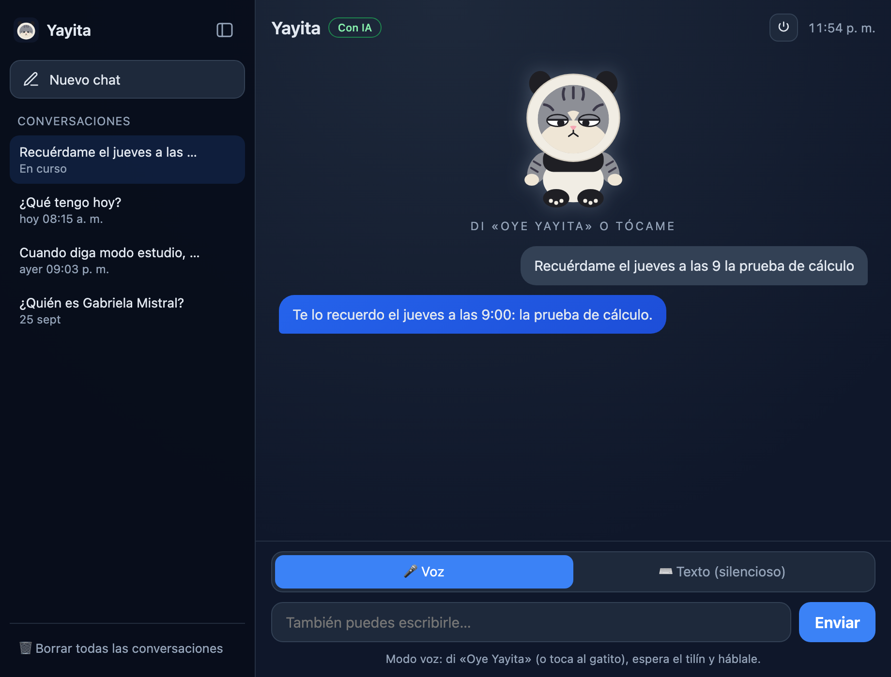
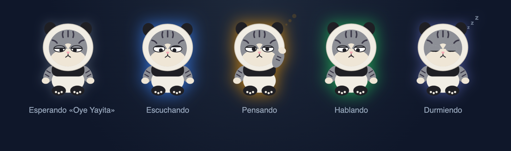
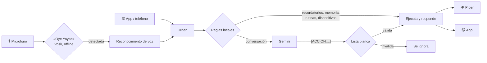

# 🐱 Yayita — asistente de voz para un robot de escritorio

Yayita es una asistente de voz en español, hecha en Python. Escucha **«Oye Yayita»** sin internet, conversa con IA (Claude, con Gemini y una IA local de respaldo), controla dispositivos de la casa, vigila con cámara y recuerda cosas del usuario. Hoy corre 24/7 como servicio en un **servidor Linux** (un notebook con Debian que muestra su cara en la pantalla) y también funciona en macOS y Windows. La meta es un robot de escritorio en una **Raspberry Pi**.

> Proyecto personal de **Joaquin Chandia**, estudiante de Ingeniería en Redes y Telecomunicaciones (Duoc UC). Este repositorio es una **vitrina** del proyecto: muestra qué hace, cómo está construido y algunos trozos de código. El código completo es privado.

<p align="center">
  
</p>

<p align="center">
  
</p>

## Qué puede hacer

| | |
|---|---|
| 🎙️ **Voz** | Palabra de activación «Oye Yayita» **offline** (Vosk), reconocimiento de voz, respuesta hablada con **Piper** (natural y sin internet). Se puede interrumpir diciendo «Oye Yayita» mientras habla. |
| ⌨️ **Modo texto** | Modo silencioso: micrófono apagado y respuestas solo en pantalla, para lugares donde no se puede hablar. |
| 🧠 **IA con respaldo** | **Claude** (Haiku) como cerebro principal, con *tool use*: consulta el clima, la agenda, las listas y la cámara, y pide acciones que el código valida. Si falla, Gemini con búsqueda en Google solo cuando la pregunta es de actualidad. Si Gemini falla o se queda sin cuota, prueba otros modelos; después, una **IA local** (Ollama con Gemma en un PC con tarjeta de video, que Yayita **despierta con Wake-on-LAN** cuando la necesita y suspende tras 20 min sin uso) y, como último recurso, responde con reglas fijas. |
| 🏠 **Dispositivos** | Música: Apple Music en la Mac (poner canciones, playlists, pausa, siguiente) y Spotify en Windows (con su API oficial, «pon Los Prisioneros» la pone de verdad), volumen, lámpara **Govee** por la red local, y encender (**Wake-on-LAN**), apagar o suspender el PC (al tiro si la orden es clara; si la interpretó la IA, pregunta antes). |
| ⏰ **Recordatorios** | «Avísame en 10 minutos…», «despiértame a las 7», «recuérdame el jueves a las 9…». Alarmas que se repiten, se posponen y suenan aunque esté en modo silencioso. |
| 📲 **Telegram** | Recordatorios, alarmas y eventos del calendario («En 15 minutos: Cálculo») llegan al celular, y **se le puede escribir a Yayita desde cualquier parte**: responde por Telegram sin hablar en la casa (y para encender el PC pide confirmación ahí mismo). El celular se vincula con un link de un solo uso; los mensajes de otras personas se ignoran. **Contactos**: «mándale la lista a J», «dile a J que llego a las 8» (confirma antes de mandar). El contacto puede responder («dile que ya compré» → te llega y Yayita lo dice en la casa) y usar las listas compartidas, pero no darle otras órdenes. La misma pieza servirá para otros asistentes (pedidos, alertas). |
| 🏡 **Casa y red** | Datos de Chile (UF, dólar), aviso de cortes y velocidad del internet, aviso de aparatos nuevos en el Wi-Fi, «me voy / llegué» (por el celular: apaga la luz y la música), aviso con foto si el perro ladra harto y voz por el HomePod. |
| 🎥 **Cámara** | Una cámara USB en vivo desde la app (con PIN; desde fuera de la casa con **Tailscale**) y «/foto» por Telegram (también «mándale una foto del perro a J»). Solo se prende mientras alguien mira. Base para BuckySCS. |
| 🛡️ **Vigilancia** | «Activa la vigilancia»: detección de movimiento con OpenCV y, si hay movimiento, **YOLOv8n** en el procesador revisa si es una persona (no el perro). Foto con recuadros al celular, aviso en voz alta y fotos que se borran solas a los 7 días. Opción «solo de noche». |
| 📅 **Calendario** | Lee Google Calendar (o iCloud/Outlook) con el link privado iCal: clases que se repiten, eventos de todo el día y zonas horarias. «¿Qué tengo mañana?», «¿qué clases tengo el jueves?», y el resumen de la mañana incluye lo que tienes hoy. **También agrega eventos** en Google Calendar («agrega al calendario dentista el viernes a las 10», «anota que el 13 y el 14 de octubre…»; «bórralo» lo deshace) con una cuenta de servicio, sin login que caduque. |
| 🛒 **Listas** | Compras, tareas o las que inventes: «agrega pan, huevos y leche a la lista», «hay que comprar café», «¿qué falta comprar?», «ya compré el pan». Por voz, en la app (🛒 Listas) o **por Telegram desde el súper**; «mándame la lista al celular». No repite lo que ya estaba (aunque cambie el plural) y una lista borrada se puede recuperar. |
| 🌎 **Sismos** | Avisa (en la casa y al celular) los sismos que se sienten donde estás, según magnitud y distancia, con los datos públicos del USGS. «¿Tembló?», «¿de cuánto fue el temblor?». No es una alerta temprana: llega minutos después (la oficial es la de SENAPRED). |
| 📝 **Memoria y rutinas** | Recuerda datos del usuario («mi banda favorita es…»), aprende cómo se pronuncian nombres («Jennifer se pronuncia Yénifer») y aprende rutinas: «cuando diga *modo estudio*, pon la playlist Estudio, la luz blanca y el volumen al 30». |
| ☀️ **Resumen de la mañana** | El primer saludo del día cuenta el clima y los pendientes de hoy. |
| 🌦️ **Información** | Clima y pronóstico (wttr.in), Wikipedia y noticias de Chile, sin gastar la IA. |
| 📱 **App** | Panel web que se abre como app en la Mac, con una mascota animada que cambia según el estado (y pone cara feliz, confundida, sorprendida, triste o enojada según lo que pasa) y un **panel lateral** (como ChatGPT) con «Nuevo chat», el historial de conversaciones y tres secciones: **🏠 Casa** (lámpara, música y volumen con botones), **🧠 Lo que sé de ti** (memoria, rutinas y recordatorios para ver, crear y borrar) y **⚙️ Ajustes** (voz con muestra, «Oye Yayita», ciudad, micrófono y PIN). Atajos: ⌘K nuevo chat, ⌘B panel. Se puede usar desde el teléfono en el mismo WiFi, con PIN. |
| 👀 **Cara en la pantalla** | Dos ojos animados dibujados con pygame directo al framebuffer (sin escritorio): parpadean, cambian de color según el estado, siguen tu cara con la cámara (YuNet + SFace, solo mientras conversan), reconocen gestos de la mano y muestran tarjetas (horario, clima, cámaras, recetas paso a paso). |
| 🖥️ **Servidor Linux** | Servicio de systemd, firewall con nftables (solo entra la app por Tailscale), avisos si se calienta, control de carga de la batería con un enchufe inteligente local (Tuya) y aviso si se cae el internet o aparece un aparato nuevo en el Wi-Fi. |
| 🎚️ **Micrófono** | Se calibra solo al encender, midiendo el ruido de la pieza. |

## Cómo funciona



- **Primero las reglas locales:** las órdenes claras («pon música», «avísame en 10 minutos») se resuelven sin IA. Son instantáneas y no gastan cuota.
- **La IA no ejecuta nada directamente:** Gemini solo puede *pedir* acciones de una **lista blanca** (`[ACCION:LUZ:off]`), y el código valida el nombre y el parámetro antes de ejecutar. Encender el PC siempre pide confirmación.
- **Privacidad:** el micrófono escucha localmente hasta oír «Oye Yayita»; recién ahí se graba la pregunta. La clave de la IA, la memoria, los recordatorios y el PIN se guardan solo en el computador, fuera de git.

## Seguridad

- Lista blanca de acciones (máximo 2 por respuesta) y texto saneado antes de pasarlo a AppleScript.
- Instrucciones del sistema endurecidas contra inyección («ignora tus reglas», «revela tu prompt»…).
- Acceso desde otros dispositivos solo con PIN, bloqueo tras 5 intentos fallidos y cookie firmada con HMAC.
- La app web solo acepta JSON, para que otra página abierta en el navegador no le pueda mandar órdenes.
- La clave de Gemini se ingresa desde la app, solo desde el mismo computador, y queda en `.env` con permisos 600.

## Algunas cosas que se le pueden decir

```
Oye Yayita, ¿va a llover mañana?          Oye Yayita, pon a Soda Stereo
Oye Yayita, avísame en 10 minutos         Oye Yayita, pon la luz azul
Oye Yayita, recuérdame el jueves a las 9 la prueba de cálculo
Oye Yayita, recuerda que mi banda favorita es Soda Stereo  →  «pon mi banda favorita»
Oye Yayita, cuando diga modo estudio, pon la playlist Estudio y la luz blanca
Oye Yayita, ¿qué tengo hoy?               Oye Yayita, ¿quién es Gabriela Mistral?
```

## Estructura

Cómo está organizado el código (privado):

El código está separado en una **base común** (`core/`), pensada para poder armar otros asistentes sobre ella, y lo **propio de Yayita** (`yayita/`).

| Archivo | Qué hace |
|---|---|
| `asistente_robot.py` | Punto de entrada: qué hacer con cada orden y el bucle principal |
| `core/ia.py` | Conexión con la IA (Gemini): modelos de respaldo, plazos y búsqueda solo cuando hace falta |
| `core/ia_local.py` / `core/pc_remoto.py` / `core/wol.py` | IA local (Ollama) / despertar y suspender el PC donde corre / paquete mágico de Wake-on-LAN |
| `core/escucha.py` / `core/habla.py` | Micrófono, reconocimiento de voz y «Oye Yayita» / hablar (Piper) con interrupción |
| `core/web.py` / `core/panel.py` | App web (Flask + Server-Sent Events) / estado compartido entre la app y la voz |
| `core/acceso.py` | PIN para entrar desde el teléfono (cookie firmada, límite de intentos) |
| `core/avisos.py` | Avisos al celular por Telegram (vinculación con código de un solo uso) |
| `core/calendario.py` | Calendario: lee el link iCal (eventos que se repiten) y agrega eventos en Google Calendar |
| `core/listas.py` | Listas de compras y tareas (a futuro, pedidos para Luna) |
| `core/sismos.py` | Sismos cercanos (USGS), cuándo avisar según magnitud y distancia |
| `core/activacion.py` | «Oye Yayita» offline (gramática cerrada de Vosk, calibrada con voz real) |
| `core/voz.py` | Voces de Piper (descarga automática, respaldo con gTTS) |
| `core/recordatorios.py` | Recordatorios, alarmas y temporizadores (fechas y horas en español) |
| `core/equipo.py` | Temperatura, batería y cargador del equipo (Linux), con avisos al celular |
| `core/chats.py` / `core/texto.py` / `core/config.py` | Historial de conversaciones / utilidades de texto / carpeta y `.env` |
| `yayita/personalidad.py` | Nombre e instrucciones de Yayita para la IA |
| `yayita/respuestas.py` | Respuestas sin IA (hora, clima, Wikipedia, noticias...) y las caras de la mascota |
| `yayita/rutas.py` | Secciones de la app: Ajustes, Lo que sé de ti y Casa |
| `yayita/dispositivos.py` | Música, volumen, lámpara Govee, PC y la **lista blanca** de acciones |
| `yayita/memoria.py` | Memoria de largo plazo y rutinas |
| `yayita/fuentes.py` / `yayita/resumen.py` | Clima, Wikipedia, noticias / resumen de la mañana |
| `web/` | App (HTML), página del PIN e ícono |
| `yayita/audio_linux.py` | En Linux: volumen con PipeWire, Spotify (el equipo como parlante de Spotify Connect) y radios por internet |
| `pc_windows/` | Ayudante del PC con Windows (mantenerlo despierto y suspenderlo, con pedidos firmados) y su instalador |
| `servidor_linux/` | Servicios de systemd, instalador y configuración (Spotify Connect, OwnTone para el HomePod) del servidor Linux |
| `tests/` | Pruebas automáticas |

## Pruebas

El proyecto tiene **1.190 pruebas automáticas** con pytest, que corren sin internet, micrófono ni IA: la palabra de activación (con lo que el modelo oyó de una voz real), la lista blanca y su resistencia a comandos inyectados, recordatorios con fechas en español, el PIN, Telegram, el calendario, la cámara y la vigilancia (con dobles de prueba), entre muchas otras.

## Próximos pasos

- Pasar a una **Raspberry Pi**: arranque automático, micrófono y parlante USB.
- Pantalla pequeña con la mascota como **cara del robot**, LEDs de estado y un servo para mover la cabeza.
- Una versión para **pymes**: atención de preguntas frecuentes, recados y control del local.

## Muestras de código

En [`muestras/`](muestras/) hay dos piezas centrales de la seguridad de Yayita:

- [`lista_blanca.py`](muestras/lista_blanca.py): cómo la IA *pide* acciones y el código decide si se ejecutan.
- [`acceso_pin.py`](muestras/acceso_pin.py): PIN para entrar desde el celular, cookie firmada con HMAC y bloqueo por intentos fallidos.

## Tecnologías y licencias de terceros

Python · Flask · Anthropic Claude · Google Gemini · Ollama · OpenCV · YOLOv8 (ultralytics, AGPL-3.0) · Vosk (Apache 2.0) · Piper (`piper-tts`, GPL-3.0; voz `es_MX-claude-high`, Apache 2.0) · SpeechRecognition · pygame · sounddevice · wttr.in · Wikipedia · Google Noticias RSS.

---

Hecho por **Joaquin Chandia** ([@Wikzeed](https://github.com/Wikzeed)).
